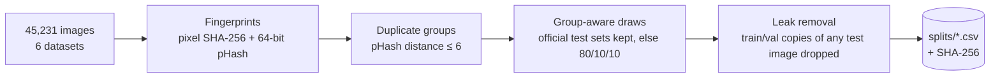
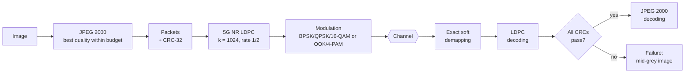
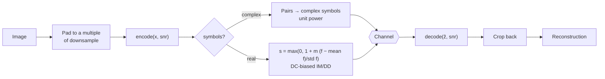

# UWBench evaluation protocol

This file specifies what UWBench fixes: data, channels, metrics, baselines, result format
and learned models. Installation and commands are in the [README](README.md).

## 1. Datasets

Sources, licenses, checksums and folder layouts: [DATASETS.md](DATASETS.md) and
[`uwbench/data/registry.yaml`](uwbench/data/registry.yaml). Version 1.0 covers optical
images.

| Key | Task | Sample | Official split used |
| --- | --- | --- | --- |
| `uieb` | enhancement / fidelity | raw + reference (890 pairs; challenging-60 excluded) | none |
| `lsui` | enhancement / fidelity | input + reference (4279 pairs) | test (400) |
| `euvp` | enhancement / fidelity | input + reference, three paired sets (11,435 pairs) | none |
| `suim` | semantic segmentation | image + mask (1635) | test (110) |
| `trashcan` | instance segmentation / detection | image, instance version (7212) | none (split by video) |
| `uicd` | captioning | image (3176), 5 captions each | none |

## 2. Deduplication and frozen splits

The splits are versioned in [`splits/`](splits/): you do not need to rebuild them. They
were built by `uwbench dedup` and `uwbench split` with
[`configs/splits.yaml`](configs/splits.yaml).

**Duplicates.** Two images are duplicates when the Hamming distance between their
perceptual hashes (`imagehash.phash`, 64 bits) is at most 6. Both images of a pair are
hashed. Duplicate groups are the connected components of these links
(`splits/duplicates.csv`). The six datasets contain 3971 groups, 3365 of which span
several datasets (mainly EUVP–LSUI, SUIM–UICD and UIEB–UICD): recoloured, enhanced or
cropped copies of the same picture. TrashCan is only compared with the other datasets,
since its dark ROV frames collide with each other at this threshold.

**Split rules.**
1. Official test splits are kept (LSUI, SUIM); their validation set is 10 % of the
   official training pool. Other datasets are split 80/10/10.
2. A duplicate group (or a TrashCan source video) is never split across partitions.
   Draws use `numpy.random.default_rng(0)`.
3. A training or validation sample is removed when its group contains a test sample of
   **any** dataset (`splits/removed.csv`). A model trained on the union of the training
   splits never sees a test image, even a modified copy.
4. Cross-dataset protocols (`splits/cross/`) train on A and test on all of B, with every
   group present in B removed from training.

TrashCan's official split is not used: 113 of the 115 videos of its validation set also
appear in its training set. Each image keeps its official folder, which tells which COCO
JSON holds its annotations.

| Dataset | Train | Val | Test | Removed |
| --- | ---: | ---: | ---: | ---: |
| UIEB | 712 | 88 | 89 | 1 |
| LSUI | 3425 | 378 | 400 (official) | 76 |
| EUVP | 8926 | 1092 | 1144 | 273 |
| SUIM | 1317 | 146 | 110 (official) | 62 |
| TrashCan | 5725 | 734 | 753 | 0 |
| UICD | 2403 | 299 | 318 | 156 |

| Cross-dataset protocol | Train | Val | Test |
| --- | ---: | ---: | ---: |
| `lsui_to_uieb` | 3425 | 378 | 889 (all of UIEB) |
| `euvp_to_uieb` | 8924 | 1090 | 889 (all of UIEB) |

Each split file has a `sample_id` column and one path column per role, relative to
`datasets/<key>/extracted/` (plus a `dataset` column in cross-dataset files). The tests
check that the files match these checksums and contain no leak.

SHA-256 of the split files

| File | SHA-256 |
| --- | --- |
| `cross/euvp_to_uieb_test.csv` | `4c2b395b32c98e1f5d12657c6312c1d9b3c7962e33f7319ca5353912ee9dd749` |
| `cross/euvp_to_uieb_train.csv` | `2005932a0fc68bc43f3baaa267e5c1439c787d291ba26256f15b2c3c45a41c94` |
| `cross/euvp_to_uieb_val.csv` | `becdfc5b795fec2dd681ae85d456cc652fafb4a5cb0736a045ba335c1b5c7291` |
| `cross/lsui_to_uieb_test.csv` | `4c2b395b32c98e1f5d12657c6312c1d9b3c7962e33f7319ca5353912ee9dd749` |
| `cross/lsui_to_uieb_train.csv` | `0fdb6ed2e78048f1fc8f5e22fe548be9e90700c7879474b2b2b7156497ee8dfb` |
| `cross/lsui_to_uieb_val.csv` | `6c61f6c51afe881c92cef01b47080a2aafc55eab072e771896af674729feff0f` |
| `duplicates.csv` | `3521519249ee5fe25fd891d86d11ded1c855180ef6add4099b1bde1a7bf78060` |
| `euvp_test.csv` | `7d58dc38bf346c4b1a15850b79aadf1b5caf8dd01d48cb208483e8c41c6700cc` |
| `euvp_train.csv` | `ac25e32fdf98bceffa9e130f9e60ba3334a12eaa490f76f9feb0a5bbddcd16f2` |
| `euvp_val.csv` | `e72519bb6ec645b364f200cd8278e340cf893d89d5c2856efa7d8f1a3700648e` |
| `lsui_test.csv` | `e109153539accb9526b01184a585da7b024cb28a8ad4e47bccd56709c1153b49` |
| `lsui_train.csv` | `f41a588ba8965aa6df92d1bbe47ec9f5dece30225e456b60450842a5f172927d` |
| `lsui_val.csv` | `4c06445861a23585bc409aff05bab4963456e8d5775f927a18a106bbca29e13a` |
| `removed.csv` | `c306325f2aad3afa8475c55448653645b4b965aad214386ea8748041b036bda9` |
| `suim_test.csv` | `e832d9f033d0426393f33b9309cf95678f3efde6a4cdcc2d9a5a0e34160f5d43` |
| `suim_train.csv` | `e80fdb4f040cd5f3fdfcb2a5739464b7b81b5cce0d790097abfa29d760d6450e` |
| `suim_val.csv` | `7d41dff4659ac4ef3b0ccc97194353d3b83c7d2d2e012bebb65abfb72a154b53` |
| `trashcan_test.csv` | `655bd3dbf3509d24c70af8151a02b926b8ecff9e99c4776fb6b93389de2a1bb3` |
| `trashcan_train.csv` | `66c0899f60d7c70b36fbaac55fb659be5c9980326e7c28cd807d04174b2364b0` |
| `trashcan_val.csv` | `b947d0121effaf359fbfcb10936c043b6f4d1bbbea2c87a18ccbc63674b33394` |
| `uicd_test.csv` | `b3afd10dac168b670b7c8ff408e8a0cb5da6bb4dd3c93dfe1a978373bb3d9362` |
| `uicd_train.csv` | `7695d5ee14020a34e4b6ce9e3284bb5c4d7704bbd888155de232f8decfdc41ed` |
| `uicd_val.csv` | `01720c6286ff0ea5f5964f640820e53e3544f5d27dd5750437694d5a1660bf79` |
| `uieb_test.csv` | `5a114ba0691874e3140b3f50ca0edffc3c45689837743e9f0cf265bb0caff6c5` |
| `uieb_train.csv` | `2b122792f42064dfbca70923972b4d2b2a71f7f3b09c1a638ed416011b49fadf` |
| `uieb_val.csv` | `1197a13afafce683f9653927734d3c0ff6eee396cf33b64dfe3402ee8d876bbb` |

## 3. Reference channels

Code: [`uwbench/channels/`](uwbench/channels/). Scenarios:
[`configs/scenarios/`](configs/scenarios/). Each channel implements
`forward(x, snr_db, rng) -> y` once in PyTorch: it is differentiable for training, and
the same code serves evaluation. All randomness comes from an explicit
`numpy.random.Generator`.

**Conventions.** Symbols are `(B, n)`, one row per image. Acoustic and AWGN channels take
complex baseband symbols normalised to `E|x|² = 1` per row. Optical channels take real
non-negative intensities normalised to unit mean optical power per row. Channels return
the receiver's estimate with perfect channel knowledge (CSI). `snr_db` is a scalar, one
value per row, or `None` (noiseless).

### 3.1 AWGN (control)

y = x + n, n ~ CN(0, σ²), SNR = 1/σ².

### 3.2 Modelled acoustic channel with OFDM (`uac_ofdm`)

Formulas from Lucani, Médard and Stojanovic, arXiv:0801.0426, eqs. (1)–(8), consistent
with eq. (1) of the survey.

- **Path loss:** A(l, f) = l^k a(f)^l, with l in km and k = 1.5.
- **Absorption (Thorp):** 10 log a(f) = 0.11 f²/(1+f²) + 44 f²/(4100+f²) + 2.75·10⁻⁴ f²
  + 0.003 dB/km, f in kHz.
- **Ambient noise** (dB re µPa/Hz, summed in linear power): turbulence
  17 − 30 log f; shipping 40 + 20(s − 0.5) + 26 log f − 60 log(f + 0.03); wind
  50 + 7.5 √w + 20 log f − 40 log(f + 0.4); thermal −15 + 20 log f.
- **Multipath:** image method in an isovelocity waveguide (pressure-release surface,
  reflecting bottom), at most `max_reflections` bounces. Each path has amplitude
  r_s^{n_s} r_b^{n_b} / √A(l_p, f_c), delay l_p / c and a random phase per realisation;
  the response has unit energy. There is no sound-speed profile: this model is a common
  reference, not a substitute for Bellhop.
- **OFDM:** unitary FFT, cyclic prefix at least the delay spread (checked). Subcarrier k
  has noise variance σ² c_k, with c_k = A(R, f_k) N(f_k) / mean(A N). One-tap MMSE
  equalisation with perfect CSI.
- **Doppler:** a residual frequency offset per OFDM symbol, ε ~ N(0, cfo_std²)
  subcarrier spacings. Wideband time compression is not modelled.
- **SNR:** average received SNR per subcarrier, 1/σ².

### 3.3 Watermark replay (`watermark_ofdm`)

Replay of the measured channels of van Walree et al., IEEE JOE 2017. The data
(`WatermarkV1.zip`, FFI) is not redistributed; see DATASETS.md.

- Each `.mat` file holds a time-varying impulse response (snapshots × K taps). The replay
  is an exact port of `replayfilter.m` (linear interpolation between snapshots), checked
  against the MATLAB loop.
- OFDM at `fs_tau` in the channel band, with a cyclic prefix of at least K − 1 samples.
  Each image uses a random file and start time.
- Perfect CSI is the frequency response averaged over each FFT window; equalisation is
  one-tap MMSE. The residual inter-carrier interference is part of the channel: with
  NOF1 and N = 1024, the error floor is −9.2 dB without noise. This is why a replayed
  channel is harder than the modelled one.
- Each file is normalised to unit energy; white noise is added at the requested SNR. The
  recorded ambient noise is not replayed.

### 3.4 Optical IM/DD channel (`uwoc`)

y = h s + n, with h = h_l h_a h_p, constant over one image (block fading).

- **Attenuation h_l = exp(−c d):** Beer–Lambert, eq. (2) of the survey, with c from
  Table III ([`configs/uwoc_water.yaml`](configs/uwoc_water.yaml), 532 nm): clear ocean
  0.15, coastal ocean 0.305, turbid harbor 2.17 m⁻¹.
- **Turbulence h_a,** with E[h_a] = 1: log-normal, h_a = exp(2X) with
  X ~ N(−σ², σ²) and σ² = ln(1 + SI)/4; or Gamma-Gamma with
  SI = 1/α + 1/β + 1/(αβ).
- **Pointing errors h_p:** Farid and Hranilovic (JLT 2007), h_p = A₀ exp(−2r²/w²_zeq),
  Rayleigh radial displacement r.
- **Noise:** Gaussian, variance σ²_th (1 + ζ h s), ζ being the shot-to-thermal ratio
  (ζ = 0: thermal noise only).
- **Input:** non-negative intensities (the channel rejects negative values), unit mean
  optical power.
- **Receiver:** with perfect CSI, r = y / h has noise variance v. Learned decoders receive
  the linear MMSE estimate 1 + (r − 1) / (1 + v), which stays bounded in deep fades; the
  separation baseline computes its LLRs from r and v.
- **SNR:** transmit electrical SNR, 1/σ²_th. The received SNR is SNR · h², so water type,
  distance, turbulence and pointing shift the curves as in a link budget.

### 3.5 Scenarios

| Scenario | Channel | Main parameters | SNR grid (dB) |
| --- | --- | --- | --- |
| `awgn` | AWGN | — | −5 : 5 : 25 |
| `uac_modeled_short` | `uac_ofdm` | 1 km, 10–18 kHz (f_c 14 kHz, B 8 kHz), N 1024, CP 512, depth 100 m, wind 5 m/s, s 0.5, CFO std 0.01 | −5 : 5 : 25 |
| `uac_modeled_long` | `uac_ofdm` | 5 km, 4–8 kHz (f_c 6 kHz, B 4 kHz), N 256, CP 64, otherwise as above | −5 : 5 : 25 |
| `uac_watermark_nof1` | `watermark_ofdm` | NOF1 (Oslofjord, 10–18 kHz), N 1024, CP 2048 samples at 16 kHz | −5 : 5 : 25 |
| `uwoc_clear` | `uwoc` | clear ocean, 20 m (loss 26.1 dB) | −5 : 5 : 50 |
| `uwoc_coastal` | `uwoc` | coastal ocean, 10 m (26.5 dB) | −5 : 5 : 50 |
| `uwoc_turbid` | `uwoc` | turbid harbor, 2 m (37.7 dB) | −5 : 5 : 50 |
| `uwoc_turbulence_weak` | `uwoc` | clear ocean, 20 m, log-normal SI 0.1 | −5 : 5 : 50 |
| `uwoc_turbulence_moderate` | `uwoc` | clear ocean, 20 m, Gamma-Gamma α = β = 4 (SI 0.5625) | −5 : 5 : 50 |
| `uwoc_pointing` | `uwoc` | clear ocean, 20 m, aperture radius 5 cm, beam radius 20 cm, jitter 5 cm | −5 : 5 : 50 |

The acoustic bands are Watermark bands. Distances, geometry, wind, reflection
coefficients, residual CFO, scintillation indices and pointing parameters are choices of
this benchmark, not values from the survey.

## 4. Metrics

Code: [`uwbench/metrics/`](uwbench/metrics/). Every metric is computed per image; results
report the mean over images with a 95 % confidence interval.

**Fidelity.** Reconstructions are clamped to [0, 1] and scored in floating point.
- **PSNR:** 10 log₁₀(1/MSE) per image, over all pixels and colour channels, averaged over
  images. Identical images score 100 dB instead of infinity.
- **MS-SSIM:** `pytorch_msssim` with its defaults (window 11, σ = 1.5, five scales). Both
  image sides must be at least 161 px; every test image of the six datasets is.
- **LPIPS:** `lpips` 0.1.4, AlexNet backbone, inputs in [−1, 1]. Lower is better.

**Rate.**
- Digital schemes: bpp = n_bits / (H W), measured on the actual codestream.
- Analog schemes: bandwidth ratio ρ = k / n, with n = C H W source components and k
  channel uses per image (Bourtsoulatze et al., 2019). A channel use is one complex symbol
  on AWGN and acoustic channels, one real symbol on the optical channel.
- Conversion: a scheme carrying η information bits per channel use satisfies
  **ρ = bpp / (C η)**. For example, 0.5 bpp with QPSK and a rate-1/2 code on RGB images
  gives ρ = 1/6.

**Complexity.** Parameters; FLOPs per image from `torch.utils.flop_counter` (one
multiply-add = 2 FLOPs; matrix products and convolutions); latency as mean, standard
deviation and median after warm-up, always reported with the platform.

A task metric (mIoU on SUIM) is not part of version 1.0: the only official segmenter is a
Keras model without a verified PyTorch port.

## 5. Separate source-channel coding baseline

Code: [`uwbench/baselines/`](uwbench/baselines/) (`pip install -e .[baseline]`).

1. **Budget.** k_ch = ⌊ρ C H W⌋ channel uses. With m bits per symbol and an LDPC code
   (k, n), N = ⌊k_ch m / n⌋ packets of k − 32 payload bits.
2. **Source coding.** JPEG 2000 (OpenJPEG via Pillow, the reference codec) or JPEG, at
   the best quality whose actual size, headers included, fits the budget (bisection).
3. **CRC-32** at the end of each packet.
4. **LDPC.** 5G NR codes (3GPP TS 38.212), 20 belief-propagation iterations, from NVIDIA
   Sionna. Default k = 1024, rate 1/2.
5. **Modulation** (Gray labelling): BPSK, QPSK, 16-QAM at unit power for complex
   channels; OOK {0, 2} and 4-PAM {0, 2/3, 4/3, 2} at unit mean intensity for the optical
   channel.
6. **Receiver.** Zero-forcing estimate and per-symbol noise variance with perfect CSI,
   exact log-sum-exp LLRs, LDPC decoding, CRC check, source decoding.

**Failure policy.** An image is not decoded when the budget cannot hold the
lowest-quality codestream, when any packet fails its CRC, or when the codestream does not
decode. The failure rate is reported separately. Curves that include failures score an
undecoded image on a uniform mid-grey image (value 128: 11.8 dB on UIEB).

**Ideal adaptation.** Each (modulation, rate) pair is a separate scheme; the ideal
adaptation curve takes, at each SNR, the best one by mean PSNR including failures.

**Ideal separation bound.** JPEG 2000 at bpp = ρ C C̄, received without error, where C̄
is the capacity per channel use of the current realisation (mean log₂(1 + 1/vᵢ) for
complex channels, half of it for the real optical channel). It is not achievable
(infinite blocks, Gaussian inputs, no non-negativity constraint, no inter-carrier
interference) and it bounds separation with JPEG 2000 only: when the capacity is too low
for JPEG 2000 to code the image at all, it falls back to the mid-grey image, and a joint
scheme can do better.

## 6. Evaluation and results

Code: [`uwbench/eval/`](uwbench/eval/).

**`uwbench evaluate`** runs one system over the SNR grid of one scenario, on one split of
one dataset.
- The image sent is the `input` role of paired datasets (the raw, degraded image) and the
  `image` role otherwise; it is scored against itself.
- `--realizations` independent channel draws per image and SNR (default 1).
- Image *i* uses `numpy.random.default_rng([seed, i])`, so results do not depend on the
  number of workers.
- `--snr-step` refines the grid over the same range.

**Result schema 1.0.** `<out>/<system>_<scenario>_<dataset>_<split>.json` contains:
- the configuration: `system`, `scenario`, `dataset`, `split`, `n_images`, `snr_db`,
  `realizations`, `seed`, `limit`;
- `results`, one entry per (scheme, SNR): `n`; `failure_rate` (mean, 95 % Wilson
  interval); `bpp` of decoded images; `bandwidth_ratio_used`; `metrics` with `psnr`,
  `ms_ssim` and `lpips`, each as `_all` (failures scored on the fallback image) and
  `_decoded` (decoded images only), with mean and 95 % Student-t interval. Separation
  systems add `ideal_adaptation`, with the chosen scheme in `selected_scheme`;
- `provenance`: git commit and uncommitted changes, uwbench and library versions,
  platform, UTC time, command line;
- `per_image_csv`: the file with one row per (scheme, SNR, realisation, image).

**`uwbench report`** groups result files by (scenario, dataset, split) and draws, per
group, PSNR, MS-SSIM and LPIPS including failures with 95 % bands, and the failure rate.
It also writes Markdown and LaTeX tables.

## 7. Learned reference models

Code: [`uwbench/models/`](uwbench/models/). Configurations:
[`configs/models/`](configs/models/).

### 7.1 Interface and transmission

A model implements `encode(x, snr_db) -> z` (a real latent) and
`decode(z_hat, snr_db) -> x_hat`, with the attributes `downsample` and `symbols`. The
benchmark transmits the latent identically for every model:

- **Complex symbols:** the flattened latent (f₁…f₂ₖ) gives fᵢ + j f_{k+i}, normalised to
  unit mean power.
- **Real symbols (IM/DD):** s = max(0, 1 + m (f − mean f) / std(f)) per image, a
  zero-mean signal of power m² on a DC bias of 1 (m = 1). The mean is removed so that
  the encoder cannot move the operating point; the AC power then matches that of OOK.
  The bias is removed after the channel.
- **Bandwidth ratio:** k/n = c·h·w / (2·3·H·W) for complex symbols, without the factor 2
  for real ones. With ρ = 1/6: c = 16 for DeepJSCC and ADJSCC (downsampling 4), c = 256
  for WITT (downsampling 16), with complex symbols.

### 7.2 Models

| Model | Source of the architecture | Parameters (ρ = 1/6, complex) |
| --- | --- | ---: |
| DeepJSCC | Bourtsoulatze et al., TCCN 2019 (Fig. 2); open choices from `chunbaobao/Deep-JSCC-PyTorch` (inspiration) | 0.16 M |
| ADJSCC | official code https://github.com/alexxu1988/ADJSCC (MIT), translated from TensorFlow | 10.8 M |
| WITT | official code https://github.com/KeYang8/WITT (high-resolution configuration), re-written | 28.3 M (28.2 M in the paper) |

- **Licenses.** The DeepJSCC and WITT repositories have no license: their code was read
  for the architecture and hyperparameters, not copied. ADJSCC is MIT and translated with
  attribution; its GDN is re-implemented from Ballé et al., ICLR 2016.
- **DeepJSCC choices** (from the cited repository): padding 2, output padding 1, one
  PReLU parameter per layer, Kaiming/Xavier initialisation, Adam with lr 10⁻³ and weight
  decay 5·10⁻⁴.
- **WITT choices** (official code where the paper differs or is silent): depths
  [2, 2, 6, 2] and heads [4, 6, 8, 10], mirrored in the decoder; final LayerNorm; Channel
  ModNet as in the code; clamp to [0, 1] instead of an output sigmoid.
- **Deviations common to all:** power normalisation per image; padding of feature maps
  whose side is not a multiple of the window (WITT); single-stage training; training data
  and crops set by §7.3.
- No claim is made to reproduce the papers' numbers.

### 7.3 Training (`uwbench train`)

- **Data:** the `train` splits of LSUI, EUVP and UIEB (no duplicate of any test image);
  random 128 × 128 crops with horizontal flips.
- **Loss and optimiser:** MSE, Adam with each configuration's settings (DeepJSCC lr 10⁻³
  with weight decay; ADJSCC and WITT lr 10⁻⁴). The learning rate is halved when the
  validation PSNR has not improved for 5 epochs (minimum 10⁻⁶). Gradients are clipped to
  a norm of 1.
- **SNR:** drawn uniformly over the scenario's range, through the evaluation channel. One
  model is trained per scenario and evaluated at every SNR of its grid.
- **Model selection:** validation PSNR averaged over 512 fixed validation images and the
  scenario's SNR grid; the best epoch is kept.
- **Stopping:** after 20 epochs without improvement, or at 200 epochs.
- **Resume:** re-running the same command continues from `last.pt`; a converged run is
  not continued.
- **Outputs:** `checkpoints/<model>_<scenario>/{best,last}.pt` and `log.csv` (training
  MSE, validation PSNR, time and largest gradient norm per epoch). Batch sizes fit a 24 GB
  GPU.

**Reference runs.** DeepJSCC and ADJSCC on `uac_modeled_short`, `uwoc_clear` and
`uwoc_turbulence_moderate`, plus a mismatch test (trained on `uwoc_clear`, tested on
`uwoc_turbid` with `--checkpoint`). The DeepJSCC runs stopped after 52 to 144 epochs; the
ADJSCC runs reached the 200-epoch cap with less than 0.1 dB gained over their last 50
epochs. WITT has no reference run yet.
