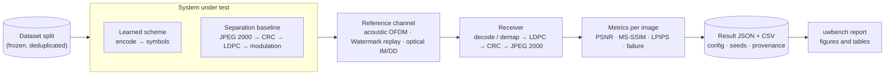
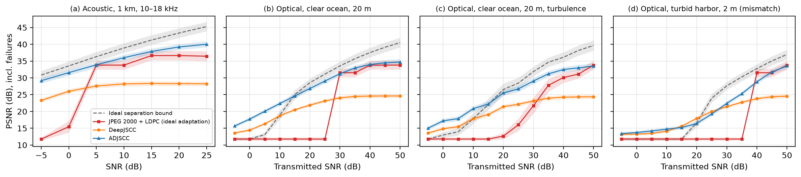
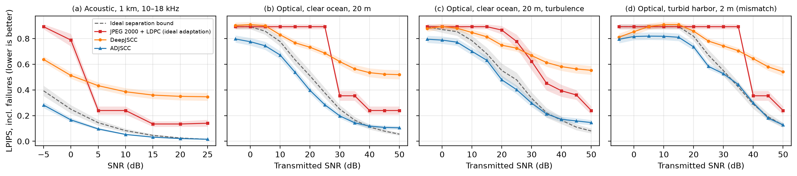

# UWBench

[](https://github.com/OWNER/REPO/actions/workflows/ci.yml)
[](https://doi.org/10.5281/zenodo.XXXXXXX)
[](LICENSE)

**UWBench** is a benchmark for underwater semantic communications. It is the reference
implementation of the unified evaluation protocol proposed in the survey *Enabling
Intelligence in the Deep: A Comprehensive Survey of Semantic Communications for Underwater
Wireless Systems*.

Existing works evaluate their schemes on different channels, datasets, rates and metrics,
so their results cannot be compared. UWBench fixes these choices once:
- **reference channels:** modelled and measured (Watermark) acoustic links, optical IM/DD
  links with attenuation, turbulence and pointing errors;
- **frozen, deduplicated splits** of six public underwater image datasets;
- **metrics:** PSNR, MS-SSIM, LPIPS, failure rate, rate and complexity;
- **baselines:** a separate source-channel coding chain (JPEG 2000 + 5G NR LDPC) with its
  ideal separation bound, and re-implemented DeepJSCC and ADJSCC;
- **one result format and report**, with full provenance.

The full specification is in [PROTOCOL.md](PROTOCOL.md).

## How it works



Every system is run over the SNR grid of a scenario, on the same images, with the same
seeds and the same channel code. A new model only has to implement `encode` and `decode`
(see [Evaluating your own model](#evaluating-your-own-model)).

## Reference results

UIEB test split (89 images), bandwidth ratio ρ = k/n = 1/6, one channel realisation per
image and SNR, 95 % confidence bands. Optical SNRs are transmitted electrical SNRs: 20 m
of clear ocean costs 26.1 dB, 2 m of turbid harbor 37.7 dB. In (d), the learned models
are those trained on clear ocean (b), to measure mismatch.





- The separation chain shows the **cliff effect**: no image is decoded below a threshold
  SNR (mid-grey fallback, 11.8 dB), then the quality saturates.
- **ADJSCC degrades gracefully.** It delivers 29.2 dB at −5 dB on the acoustic link,
  where the separation chain decodes nothing, and stays 1.7 to 5.3 dB below the ideal
  separation bound.
- **DeepJSCC** (0.16 M parameters, not SNR-aware) saturates at 28.3 dB (acoustic) and
  24.6 dB (optical).
- Under **mismatch** (d), ADJSCC is told an SNR 11.6 dB too high and loses up to 5 dB at
  low SNR, while the SNR-agnostic DeepJSCC follows its clear-ocean curve.

The result files are in [`reference_results/uieb_test/`](reference_results/uieb_test/)
(schema in PROTOCOL.md §6). The figures are regenerated with:

```bash
python scripts/plot_results.py --metric psnr --out docs/figures/psnr
python scripts/plot_results.py --metric lpips --out docs/figures/lpips
```

They were produced on an RTX 3090. Their provenance records commit `a21d35c` with local
changes, the version 1.0 code copied by hand onto the training machine.

| Model | Parameters | FLOPs per 256×256 image | Latency (RTX 3090, batch 1) |
| --- | ---: | ---: | ---: |
| DeepJSCC | 0.16 M | 1.3 G | 1.7 ms |
| ADJSCC | 10.8 M | 93.8 G | 5.8 ms |

Measured with `python scripts/complexity.py --size 256 --device cuda` (encoder and
decoder, without the channel).

## Installation

Python ≥ 3.11. Install PyTorch first:
- CPU only: `pip install torch torchvision --index-url https://download.pytorch.org/whl/cpu`;
- NVIDIA GPU (recommended for full evaluations: LDPC decoding is about 30× faster):
  `pip install torch torchvision --index-url https://download.pytorch.org/whl/cu130`.

Then:

```bash
git clone https://github.com/OWNER/REPO.git
cd REPO
pip install -e ".[dev,baseline]"
pytest
```

The `baseline` extra installs NVIDIA Sionna (`sionna-no-rt`) for the LDPC codes of the
separation baseline.

## Quick start (a few minutes)

```bash
uwbench download uieb                         # prints the license, then stops
uwbench download uieb --accept-license        # see the note below
uwbench verify uieb
uwbench evaluate --system configs/baselines/jpeg2000_ldpc.yaml \
                 --scenario configs/scenarios/uwoc_clear.yaml \
                 --dataset uieb --split test --limit 5
uwbench report results/jpeg2000_ldpc_uwoc_clear_uieb_test_limit5.json --out results/report
```

This writes:
- the result JSON (configuration, per-SNR means with confidence intervals, provenance);
- the matching `.csv`, with one row per image and SNR;
- a figure and Markdown/LaTeX tables in `results/report/`.

**Note on UIEB.** The UIEB archives are password-protected RAR files. The passwords are
published on the official page and stored in the registry, and extraction calls 7-Zip or
`unrar`. Automatic extraction has not been tested end to end. If it fails:
1. extract the three archives into `datasets/uieb/extracted/<archive name>/` with the
   passwords given in `uwbench/data/registry.yaml`;
2. run `uwbench verify uieb`, which checks every file against the manifest.

## Reproducing the reference results

The splits are versioned in `splits/` with their SHA-256 values in PROTOCOL.md, so
`uwbench dedup` and `uwbench split` do not need to be re-run.

**Separation baseline** (UIEB only):

```bash
for sc in uac_modeled_short uwoc_clear uwoc_turbulence_moderate uwoc_turbid; do
  for sy in jpeg2000_ldpc ideal_separation; do
    uwbench evaluate --system configs/baselines/$sy.yaml \
                     --scenario configs/scenarios/$sc.yaml \
                     --dataset uieb --split test --out results/uieb
  done
done
```

**Learned baselines** (training needs LSUI, EUVP and UIEB):

```bash
for m in deepjscc adjscc; do
  for sc in uac_modeled_short uwoc_clear uwoc_turbulence_moderate; do
    uwbench train --model configs/models/$m.yaml --scenario configs/scenarios/$sc.yaml
    uwbench evaluate --system configs/models/$m.yaml --scenario configs/scenarios/$sc.yaml \
                     --dataset uieb --split test --out results/uieb
  done
  # mismatch: trained on clear ocean, tested in a turbid harbor
  uwbench evaluate --system configs/models/$m.yaml --scenario configs/scenarios/uwoc_turbid.yaml \
                   --checkpoint checkpoints/${m}_uwoc_clear/best.pt \
                   --dataset uieb --split test --out results/uieb
done
uwbench report results/uieb/*.json --out results/uieb/report
```

Training stops when the validation PSNR has not improved for 20 epochs (at most 200).
On an RTX 3090, one epoch takes about 25–30 s for DeepJSCC and 80 s for ADJSCC.
Re-running an interrupted command resumes it, for training and for evaluation.

**Options of `uwbench evaluate`:**
- `--snr-step 1` refines the grid to 1 dB over the same range; the step and `--limit`
  are added to the file names, so runs never overwrite each other;
- `--workers` runs images in parallel processes (about 0.6 to 1 GB of RAM each); results
  do not depend on it. With LDPC decoding on a small GPU, keep the default of 1.

## Evaluating your own model

Any analog (learned) scheme can be evaluated with the same channels, data, metrics and
report as the baselines.

**1. Implement the interface** (`uwbench.models.base.JSCCModel`, a `torch.nn.Module`):

```python
import torch
from uwbench.models.base import JSCCModel, latent_channels

class MyModel(JSCCModel):
    downsample = 16                      # image side / latent side

    def __init__(self, bandwidth_ratio=1/6, symbols="complex"):
        super().__init__()
        self.symbols = symbols           # "complex" (AWGN, acoustic) or "real" (optical)
        c = latent_channels(bandwidth_ratio, self.downsample, symbols)
        ...                              # your layers, ending in c latent channels

    def encode(self, x, snr_db):         # x: (B, 3, H, W) in [0, 1]; snr_db: (B,)
        return z                         # real tensor (B, c, H/16, W/16)

    def decode(self, z_hat, snr_db):
        return x_hat                     # (B, 3, H, W) in [0, 1]
```

The benchmark does the rest, identically for every model:
- it pads the image to a multiple of `downsample`, then crops it back;
- it maps the latent to channel symbols: complex pairs at unit power, or a zero-mean
  signal on a DC bias, clipped at zero, for optical IM/DD;
- it applies the scenario's channel and returns the receiver's estimate to `decode`.

The latent size sets the bandwidth ratio: k/n = c·h·w / (2·3·H·W) for complex symbols,
without the factor 2 for real ones.

**2. Describe the model in YAML**, like `configs/models/deepjscc.yaml`:

```yaml
name: my_model
type: learned
model: my_package.my_module:MyModel   # any importable class
params: {bandwidth_ratio: 0.1666667}
checkpoint: checkpoints/my_model_{scenario}/best.pt   # weights under the "model" key
```

**3. Train** (optional: any training loop that saves `{"model": state_dict}` works),
**then evaluate and report:**

```bash
uwbench train --model configs/models/my_model.yaml --scenario configs/scenarios/uwoc_clear.yaml
uwbench evaluate --system configs/models/my_model.yaml --scenario configs/scenarios/uwoc_clear.yaml --dataset uieb --split test
uwbench report results/*.json reference_results/uieb_test/*uwoc_clear*.json --out results/report
```

The last command draws your curves next to the reference ones. Checkpoints are loaded
with `weights_only=True`.

**Reference models** (`uwbench/models/`, `configs/models/`):

| Model | Source | Status |
| --- | --- | --- |
| DeepJSCC (Bourtsoulatze et al., 2019) | paper architecture; open choices from `chunbaobao/Deep-JSCC-PyTorch` (inspiration) | trained, reference results |
| ADJSCC (Xu et al., 2022) | translation of the official TensorFlow code (MIT) | trained, reference results |
| WITT (Yang et al., 2023) | official architecture, re-written (the repository has no license) | implemented and tested, no reference results yet |

Deviations from the papers are listed in PROTOCOL.md §7. Trained weights are not
published.

## Commands

| Command | Purpose |
| --- | --- |
| `uwbench download <dataset> [--accept-license]` | Download from the official source (or print the manual procedure), check SHA-256, extract |
| `uwbench verify <dataset>` | Check archives, file counts and the per-file manifest |
| `uwbench dedup` | Find duplicates within and across datasets |
| `uwbench split` | Build the frozen, leak-checked splits |
| `uwbench evaluate --system … --scenario … --dataset … [--split] [--checkpoint] [--realizations] [--seed] [--snr-step] [--workers] [--limit]` | Run a system over a scenario's SNR grid |
| `uwbench report <results.json …>` | Figures (PSNR, MS-SSIM, LPIPS, failure rate) and Markdown/LaTeX tables |
| `uwbench train --model … --scenario … [--device] [--epochs]` | Train a learned model on one scenario |

## Contents

| Component | Where |
| --- | --- |
| Dataset registry (UIEB, LSUI, EUVP, SUIM, TrashCan, UICD, Watermark), download, verification | `uwbench/data/`, [DATASETS.md](DATASETS.md) |
| Deduplication and frozen splits | `uwbench/data/`, `splits/`, `configs/splits.yaml` |
| Channels: AWGN, modelled acoustic OFDM, Watermark replay, optical IM/DD | `uwbench/channels/`, `configs/scenarios/` |
| Metrics: PSNR, MS-SSIM, LPIPS, bpp and k/n, parameters, FLOPs, latency | `uwbench/metrics/` |
| Separation baseline (JPEG or JPEG 2000, CRC-32, LDPC, BPSK to 16-QAM or OOK/4-PAM) and ideal bound | `uwbench/baselines/`, `configs/baselines/` |
| Evaluation engine, result schema, report | `uwbench/eval/` |
| Model interface, training, DeepJSCC, ADJSCC, WITT | `uwbench/models/`, `configs/models/` |
| Reference results and figures | `reference_results/`, `docs/figures/`, `scripts/` |
| Tests (run by the CI) | `tests/` |

**Not included in version 1.0:** a task metric (SUIM mIoU), BPG, pilot-based channel
estimation, wideband Doppler, trained weights.

## Data policy

This repository never contains images or files from third-party datasets: only scripts,
file-identifier lists, checksums and metadata. Downloaded datasets go into `datasets/`,
which git ignores. Each dataset keeps its own license, which you must respect (see
[DATASETS.md](DATASETS.md)).

## Citation

If you use UWBench, please cite the survey and the software:

> M. Nennouche, A. Khalighi, Z. A. H. Qasem, S. Berra, and G. Kaddoum, "Enabling
> Intelligence in the Deep: A Comprehensive Survey of Semantic Communications for
> Underwater Wireless Systems," submitted, 2026.

> M. Nennouche, A. Khalighi, Z. A. H. Qasem, S. Berra, and G. Kaddoum, "UWBench: reference
> evaluation protocol for underwater semantic communications," version 1.0.0, Zenodo,
> 2026. doi: [10.5281/zenodo.XXXXXXX](https://doi.org/10.5281/zenodo.XXXXXXX).

```bibtex
@article{nennouche2026enabling,
  title   = {Enabling Intelligence in the Deep: A Comprehensive Survey of Semantic
             Communications for Underwater Wireless Systems},
  author  = {Nennouche, Mohamed and Khalighi, Ali and Qasem, Zeyad A. H. and
             Berra, Salah and Kaddoum, Georges},
  year    = {2026},
  note    = {Submitted}
}

@software{nennouche2026uwbench,
  title     = {{UWBench}: Reference Evaluation Protocol for Underwater Semantic
               Communications},
  author    = {Nennouche, Mohamed and Khalighi, Ali and Qasem, Zeyad A. H. and
               Berra, Salah and Kaddoum, Georges},
  year      = {2026},
  version   = {1.0.0},
  publisher = {Zenodo},
  doi       = {10.5281/zenodo.XXXXXXX},
  url       = {https://github.com/OWNER/REPO}
}
```

Machine-readable metadata: [CITATION.cff](CITATION.cff).

## License

Code: MIT (see [LICENSE](LICENSE)). Datasets: their own licenses.
